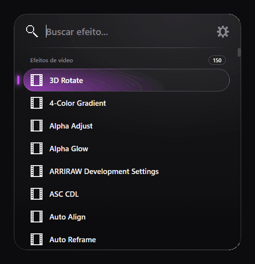

# ConsolePR

[Português](README.md)

Fast effect search for Adobe Premiere Pro and After Effects, in the style of FX Console: press a shortcut, type part of a name, and the effect is applied to the selected clips or layers.



Tested on Premiere Pro 2026 (26.5.2) and After Effects 2026 (26.5) on Windows. The global shortcut exists only on Windows. The manifest accepts version 22 or later of both apps, but versions older than the ones tested were not checked.

The panel follows the language of Premiere or After Effects: Portuguese when the app is in Portuguese, and English otherwise. `install.bat` and `uninstall.bat` follow the Windows language the same way.

## Installation

You need Windows and Premiere Pro or After Effects. Nothing else has to be installed.

1. Close Premiere and After Effects.
2. Download the project: on this page click **Code > Download ZIP** and extract it anywhere. Or use Git:

   ```bash
   git clone https://github.com/Kievy/consolePR.git
   ```

3. Double-click **`install.bat`** and wait for the completion message. If Windows shows a security warning, choose **More info > Run anyway**.
4. Open the app and press `Ctrl+Space` while it is in front.

The installer copies the extension to `%APPDATA%\Adobe\CEP\extensions\com.consolepr`, so the downloaded folder can be deleted afterwards. To update, download the new version and repeat the steps.

The extension is not signed, so the installer also turns on CEP `PlayerDebugMode` in the user registry. Without that, Premiere will not load it.

### If it does not work

- **The shortcut does not open the window:** check that the extension is listed in `Window > Extensions > ConsolePR`, and look at `%TEMP%\consolepr.log`. Another program may already be using the same combination; in that case, [change the shortcut](#changing-the-shortcut).
- **The extension is not in the menu:** make sure Premiere was restarted after installation.

### Uninstall

With Premiere and After Effects closed, double-click **`uninstall.bat`**. It removes the extension and the saved shortcut, and leaves `PlayerDebugMode` on because other extensions may need it.

## Usage

1. Select one or more clips on the Premiere timeline, or layers in the After Effects composition.
2. Press the shortcut while the app is in front.
3. Type part of the name. Accents and capitals are ignored, and letters in order also match (`gblur` finds Gaussian Blur).
4. Press `Enter` or click to apply. `↑`/`↓` move the selection. `Esc`, clicking outside, or pressing the shortcut again closes the window.

Video effects go only to video clips, and audio effects only to audio clips. In After Effects, applying an effect to several layers is undone in one step with `Ctrl+Z`. Names appear as each app reports them to the script.

The window also opens from `Window > Extensions > ConsolePR`.

## Frame capture

Click the camera button, next to the gear, to capture the frame under the playhead of the active Premiere sequence or the active After Effects composition. The image is always full quality, at the sequence or composition size, even when the preview is at 1/2 or 1/4:

- **Copy to clipboard:** paste it into another program.
- **Save as PNG or JPEG:** choose the folder and the name in the save dialog. ConsolePR remembers the last folder used.

## Keyframe easing (After Effects only)

The keyframe button, to the left of the camera, opens easing controls for the keyframes selected on the timeline:

| Control | What it does |
| --- | --- |
| `<` | Ease in (influence from 0 to 100) |
| `>` | Ease out |
| `><` | Ease in and out together |
| Square | HOLD interpolation |
| Diamond | LINEAR interpolation |
| Circle | BEZIER interpolation |

On the interpolation buttons, click to change both sides, `Alt+Click` to change only IN and `Shift+Click` to change only OUT. In After Effects a HOLD always belongs to the segment after a keyframe, so an IN hold is applied to the previous keyframe's OUT side, and the first keyframe of each property has no incoming side to hold. Sliders apply when released, and each adjustment is a single `Ctrl+Z` step. Below them, the preview shows the curve and an animation of how the motion will look.

Premiere does not expose easing to scripts, so the button does not appear there.

## Changing the shortcut

1. Open the window and click the gear next to the search field.
2. Click the shortcut field and press the new combination. It takes effect immediately, without restarting Premiere.

Use `Ctrl` or `Alt` with a letter, number, or Space, or a function key. If another program is already using that combination, the previous shortcut stays in place. **Restore default** returns to `Ctrl+Space`.

Each app stores its own shortcut. If you use FX Console in After Effects, ConsolePR takes priority over `Ctrl+Space`; change one of the two shortcuts to use both.

Settings live in `%APPDATA%\ConsolePR\config.json` and are kept across reinstalls and updates.

The shortcut is registered only while Premiere or After Effects is in front, so the same combination keeps working in other programs. While the app is in front, it takes priority over the same shortcut set inside the app itself.

## Changing the accent color

On the same gear screen, type a hexadecimal code (such as `#C64BF2`) or click the colored circle to open the color picker. The color changes immediately, is saved with the shortcut, and applies to both apps. **Default** restores the original purple.

## How it works

| Part | Role |
| --- | --- |
| `extension/background` | Invisible extension that starts with the app and owns the shortcut process |
| `extension/helper/hotkey.ps1` | Registers the shortcut, removes the window title bar, centers the window, and focuses the search field |
| `extension/palette` | Search window |
| `extension/palette/i18n.js` | Panel text in Portuguese and English |
| `extension/jsx/host.jsx` | Lists and applies effects: the QE API in Premiere and `app.effects` in After Effects |

Premiere's QE API is not documented by Adobe and may change in future versions.

Shortcut problems are recorded in `%TEMP%\consolepr.log`.

## Tests

```bash
node --test test/search.test.js test/hotkey.test.js test/color.test.js test/frame.test.js test/icons.test.js test/i18n.test.js test/keyframes.test.js
```
