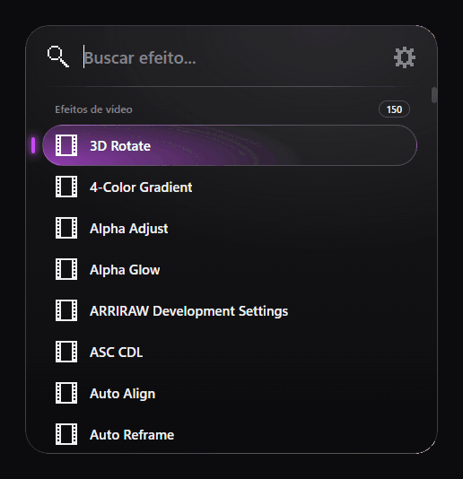

# ConsolePR

Busca rápida de efeitos para o Adobe Premiere Pro e o After Effects, no estilo do FX Console: aperte um atalho, digite parte do nome e o efeito é aplicado aos clipes ou camadas selecionados.



Testado no Premiere Pro 2026 (26.5.2) e no After Effects 2026 (26.5) no Windows. O atalho global só existe no Windows. O manifesto aceita as versões 22 ou superiores dos dois programas, mas versões anteriores às testadas não foram verificadas.

## Instalação

Você precisa de Windows e do Premiere Pro ou do After Effects instalado. Não é preciso instalar mais nada.

1. Feche o Premiere e o After Effects.
2. Baixe o projeto: clique em **Code > Download ZIP** nesta página e extraia o arquivo em qualquer pasta. Se preferir usar o Git:

   ```bash
   git clone https://github.com/Kievy/consolePR.git
   ```

3. Dê dois cliques em **`install.bat`** e aguarde a mensagem de conclusão. Se o Windows mostrar um aviso de segurança, escolha **Mais informações > Executar assim mesmo**.
4. Abra o programa e aperte `Ctrl+Espaço` com ele em primeiro plano.

O instalador copia a extensão para `%APPDATA%\Adobe\CEP\extensions\com.consolepr`, então a pasta baixada pode ser apagada depois. Para atualizar, baixe a versão nova e repita os passos.

A extensão não é assinada, então o instalador também liga o `PlayerDebugMode` do CEP no registro do usuário. Sem isso, o Premiere não a carrega.

### Se não funcionar

- **O atalho não abre a janela:** veja se a extensão aparece em `Window > Extensions > ConsolePR` e confira o arquivo `%TEMP%\consolepr.log`. Outro programa pode já estar usando a mesma combinação; nesse caso, [troque o atalho](#trocar-o-atalho).
- **A extensão não aparece no menu:** confirme que o Premiere foi reiniciado depois da instalação.

### Desinstalar

Com o Premiere e o After Effects fechados, dê dois cliques em **`uninstall.bat`**. Ele remove a extensão e o atalho salvo, e mantém o `PlayerDebugMode` ligado porque outras extensões podem precisar dele.

## Uso

1. Selecione um ou mais clipes na timeline do Premiere, ou camadas na composição do After Effects.
2. Aperte o atalho com o programa em primeiro plano.
3. Digite parte do nome. Acentos e maiúsculas são ignorados, e letras em sequência também funcionam (`gblur` encontra Gaussian Blur).
4. Use `Enter` ou clique para aplicar. `↑`/`↓` navegam, `Esc`, clicar fora ou repetir o atalho fecham a janela.

Efeitos de vídeo vão só para clipes de vídeo, e efeitos de áudio só para clipes de áudio. No After Effects, a aplicação em várias camadas é desfeita de uma vez com `Ctrl+Z`. Os nomes aparecem como cada programa os informa ao script.

A janela também abre em `Window > Extensions > ConsolePR`.

## Print do frame

Clique no botão da câmera, ao lado da engrenagem, para capturar o frame onde está a agulha da sequência ativa no Premiere ou da composição ativa no After Effects. O print sai sempre em qualidade máxima, no tamanho da sequência ou composição, mesmo com o preview em 1/2 ou 1/4:

- **Copiar para a área de transferência:** é só colar em outro programa.
- **Salvar como PNG ou JPEG:** escolha a pasta e o nome na janela de salvar. O ConsolePR lembra a última pasta usada.

## Trocar o atalho

1. Abra a janela e clique na engrenagem ao lado da busca.
2. Clique no campo do atalho e pressione a nova combinação. Ela passa a valer na hora, sem reiniciar o Premiere.

Use `Ctrl` ou `Alt` com uma letra, número ou Espaço, ou uma tecla F. Se outro programa já estiver usando a combinação, o atalho anterior continua valendo. O botão **Restaurar padrão** volta para `Ctrl+Espaço`.

Cada programa guarda o próprio atalho. Se você usa o FX Console no After Effects, o ConsolePR tem prioridade sobre o `Ctrl+Espaço`; troque o atalho de um dos dois para usar ambos.

As configurações ficam em `%APPDATA%\ConsolePR\config.json` e são mantidas ao reinstalar ou atualizar.

O atalho só fica registrado enquanto o Premiere ou o After Effects está em primeiro plano, então a mesma combinação continua funcionando nos outros programas. Enquanto isso, ele tem prioridade sobre um atalho igual configurado no próprio programa.

## Mudar a cor de destaque

Na mesma tela da engrenagem, digite um código hexadecimal (como `#C64BF2`) ou clique no círculo colorido para abrir o seletor de cores. A cor muda na hora, fica salva junto com o atalho e vale para os dois programas. O botão **Padrão** volta para o roxo original.

## Como funciona

| Parte | Função |
| --- | --- |
| `extension/background` | Extensão invisível que inicia com o programa e controla o processo do atalho |
| `extension/helper/hotkey.ps1` | Registra o atalho, tira a barra de título da janela, centraliza e dá foco ao campo de busca |
| `extension/palette` | Janela de busca |
| `extension/jsx/host.jsx` | Lista e aplica os efeitos: API QE no Premiere e `app.effects` no After Effects |

A API QE do Premiere não é documentada pela Adobe e pode mudar em versões futuras.

Problemas com o atalho ficam registrados em `%TEMP%\consolepr.log`.

## Testes

```bash
node --test test/search.test.js test/hotkey.test.js test/color.test.js test/frame.test.js test/icons.test.js
```
